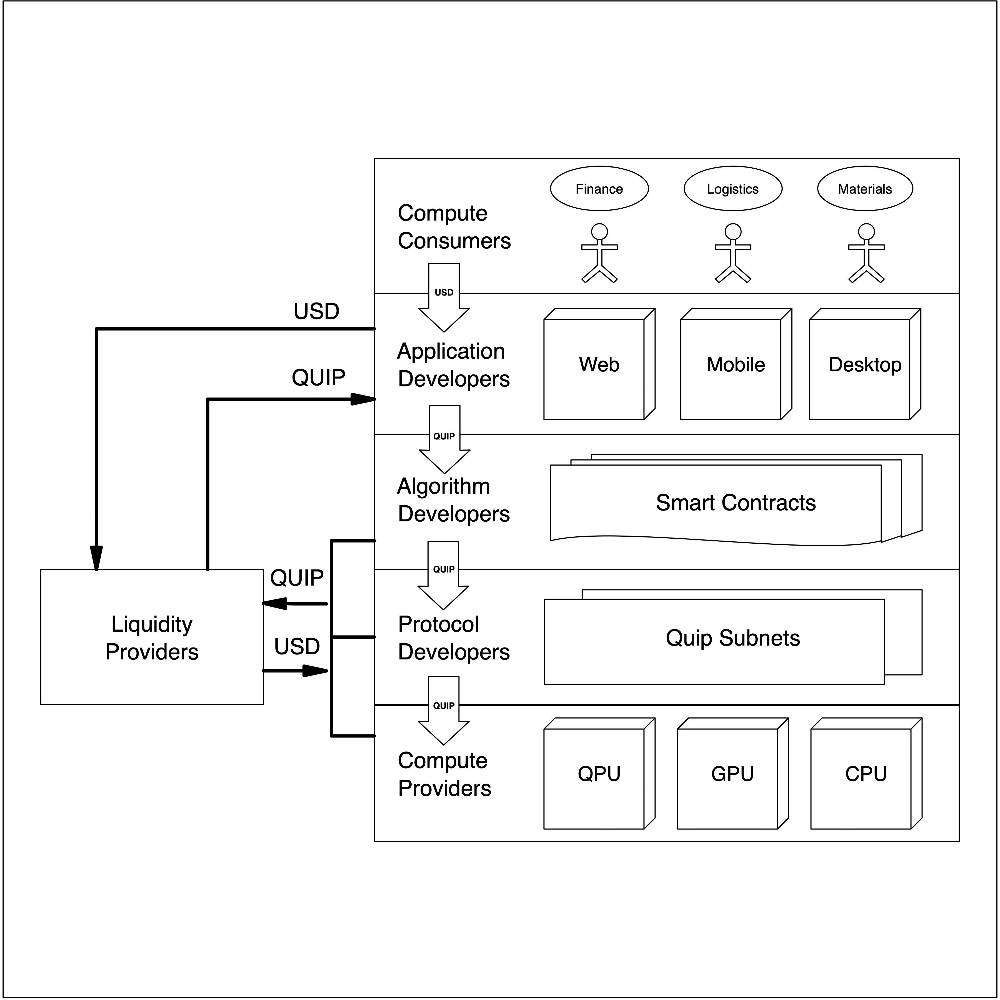
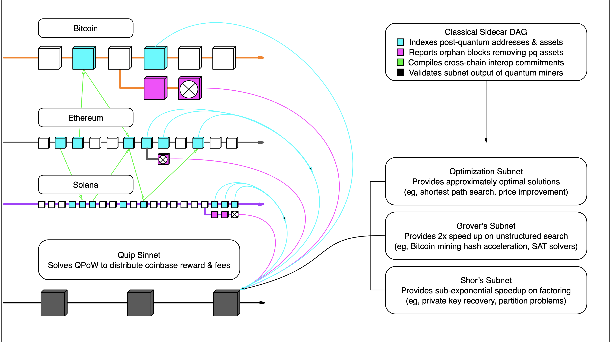
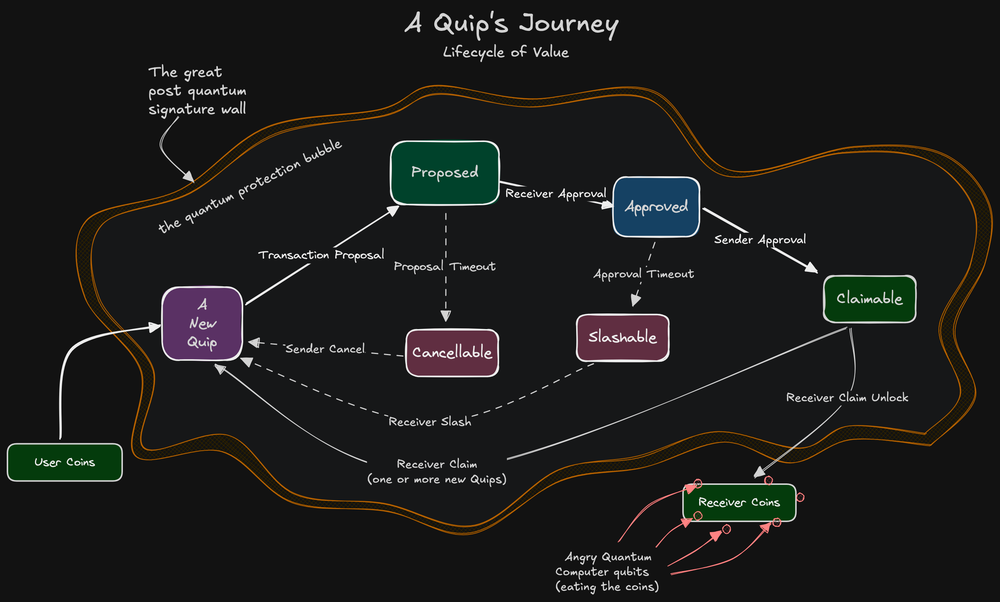

# Quickstart

The Quip protocol is published as open source software on [GitHub](https://github.com/quipnetwork/) and [GitLab](https://gitlab.com/quip.network). If you wish to run a node, you can download the desktop node runner on Windows, Linux, or Mac OSX which will guide you through setting up your environment:\
\
[https://gitlab.com/quip.network/quip-node-manager/-/releases](https://gitlab.com/quip.network/quip-node-manager/-/releases)&#x20;

For more node running options see the [Nodes section](../nodes/run-a-node-testnet.md).

Right now there's not much to do other than mine blocks, generate some quantum-resistant keys through our wallets on Ethereum, Solana, their L2s, and the Bitcoin L2s Arch and Midl, but we are building out the smart contract layer so you can take advantage of the quantum computers too.


**Under review (R5).** Newer internal records indicate Solana support was switched off in June 2026 and remains off, and that current wallet availability is narrower than the list above. The exact chain list is pending engineering confirmation, see REVIEW-TRACKER.md.


You can generate post-quantum keys to prepare for the smart contract layer by using our wallets at [account.quip.network](https://account.quip.network/) or you can use the libraries below.

If you want to understand the structure of what we're building, here's some key diagrams below:

<figure><figcaption>
The structure of the Quip Network
</figcaption></figure>

<figure><figcaption>
Quip Network interactions with other chains
</figcaption></figure>

<figure><figcaption>
The QUIP Lifecycle
</figcaption></figure>

Quip's implementation of various hash algorithms, especially the preferred Winternitz One-Time Signature (WOTS+), is available as a library for [rust](https://crates.io/crates/hashsigs-rs), [c++](https://github.com/quipnetwork/hashsigs-cpp), [typescript](https://www.npmjs.com/package/@quip.network/hashsigs), and [solidity](https://www.npmjs.com/package/@quip.network/hashsigs-solidity). If you do not want to use these libraries directly, you can use the interface at [account.quip.network](https://account.quip.network/).


**Under review (R6).** The libraries above are the previous generation. The current packages and the tags to install them with are listed on [Install the Quip SDK](install-sdk.md). Pending engineering confirmation, see REVIEW-TRACKER.md.


All Quip Network libraries and contracts are available for review at our [Github](https://github.com/QuipNetwork).

More coming soon


Want to learn more about QUIPs from scratch? Head to the [Basics](../basics/quip-the-quantum-unit-interlock-pathway.md) section to learn more.

