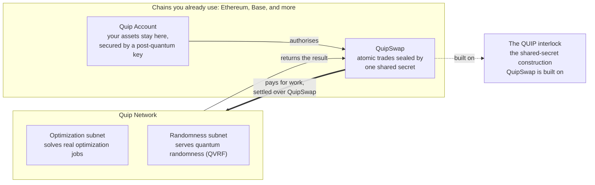
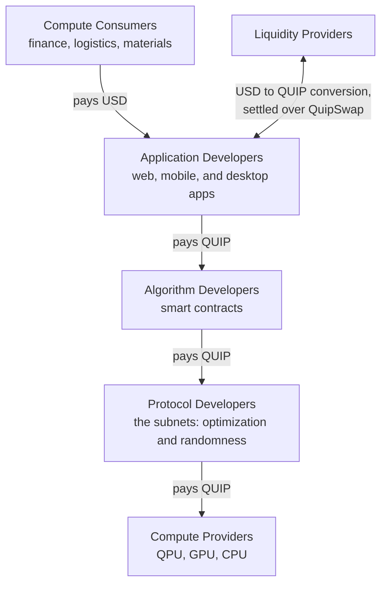

# How Quip Fits Together


**Draft — pending technical review.** This page was assembled from internal specifications on 7 August 2026 and has not been approved by engineering. Details may change before this notice is removed.


Quip is easiest to understand as a chain of four pieces, where each piece exists because of the one before it. This page walks that chain once, and every other page in this section covers one link in depth.

### The four pieces

1. **The Quantum Unit Interlock Pathway (QUIP) is the primitive.** A lockbox that releases funds only against a post-quantum signature. Everything else is built on it. See [QUIP: The Quantum Unit Interlock Pathway](../basics/quip-the-quantum-unit-interlock-pathway.md).
2. **A Quip Account is that lockbox, holding your assets.** It lives on the chain you already use (Ethereum, Base, and others), so you get post-quantum protection without moving anything. See [Quip Accounts](quip-accounts.md).
3. **QuipSwap lets two accounts trade atomically.** One shared secret settles both sides of a trade, or neither. Because that works across chains, value can move without a bridge. See [QuipSwap](quipswap.md).
4. **That same swap mechanism pays for quantum compute.** Operators are paid through the swap, so you can request work from whatever chain your assets are on. Quantum randomness is designed to be the first product sold this way. See [Quantum Randomness (QVRF)](../compute/qvrf.md).

### The whole system in one diagram

Notice what is missing from the picture: a bridge. Your assets never cross to the Quip Network. The swap carries the value instead, which means there is no bridge for anyone to attack, and no third-party bridge contract that Quip would depend on but could never upgrade.

<!-- REVIEW: confirm that Grover's and Shor's subnets from the whitepaper remain future roadmap rather than current components. (Subnet names confirmed against QPoUW Subnet 2 spec, 2026-08-01, and the Quantum Job Mempool spec, 2026-07-18.) -->

### Who pays whom

The network is a stack of participants, and every payment between layers settles the same way. This replaces the older whitepaper diagram that showed the layers with unlabeled payment arrows: the arrows now have a name, QuipSwap.

Consumers pay in ordinary money for answers. Application developers pay algorithm developers in QUIP for the smart contracts they build on. Algorithm developers pay the protocol, and the protocol pays the operators who run the hardware. Liquidity providers sit at the edge converting between the two currencies. Every QUIP hop in that chain is a payment for work one layer down, and cross-chain payments settle over the QuipSwap protocol.

### A worked example: buying an NFT

Suppose you buy a collectible NFT whose traits are generated from quantum randomness. In that single purchase, and without needing to understand any of it, you would have:

1. Created a post-quantum account that holds the NFT.
2. Paid across chains without touching a bridge.
3. Consumed quantum compute, because the randomness that shaped your NFT would have been generated on real quantum hardware and paid for through the swap.

The purchase is the whole system in miniature. Everything else in these docs is detail on one of those three steps.

### Where to go next

| If you want to | Read |
| --- | --- |
| Hold assets under post-quantum protection | [Quip Accounts](quip-accounts.md) |
| Trade without bridges | [QuipSwap](quipswap.md) |
| Buy quantum randomness | [Quantum Randomness (QVRF)](../compute/qvrf.md) |
| Submit an optimization job | [Submit Your First Compute Job](../compute/submit-a-job.md) |
| Run hardware and earn | [Run A Node](../nodes/run-a-node-testnet.md) |

<!-- SOURCES (for reviewers, not rendered):
- Founder architecture walkthrough (Colton/Brent weekly), 2026-08-06: interlock as umbrella, swap as payment rail, two-subnet testnet MVP, NFT worked example
- Quip Swap Interlock Specification — https://app.notion.com/p/314db8c6a088805dba42d4d255c4b921 — 2026-07-18
- Quantum Job Mempool Specification — https://app.notion.com/p/33edb8c6a08881f59d2de2a1f5a712c7 — 2026-07-18
- Whitepaper stack diagram (stakeholder-categories-2.png) — basis for the who-pays-whom diagram, now with labeled rails and two subnets
-->
