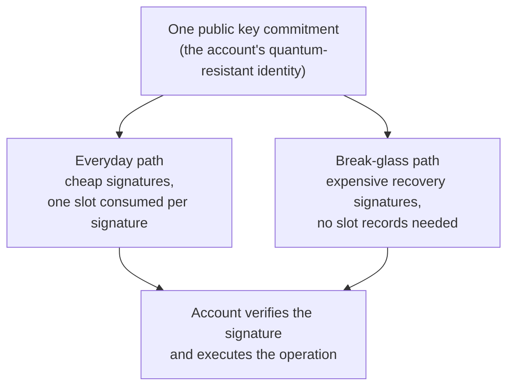

# Quip Accounts


**Draft — pending technical review.** This page was assembled from internal specifications on 7 August 2026 and has not been approved by engineering. Details may change before this notice is removed. If you are reviewing, put your answers and feedback on the [Quip Docs Review page](https://app.notion.com/p/3b5db8c6a08881788c00e65ad15ad6c4).


A Quip Account is where your assets live under post-quantum protection. This page explains what the account is, how you reach it, how its signatures work, and the one signature behavior every integrator needs to understand before relying on it.

### A lockbox on the chain you already use

A Quip Account is a smart contract deployed on the blockchain you already use. It works like a lockbox: your assets sit inside the contract, and the contract releases them only when it is shown a valid signature from a quantum-resistant key. The signature scheme is hash-based, which means its security rests on the strength of a hash function rather than on the mathematical problems that a quantum computer could one day solve.

Nothing about your assets moves to a new network. You keep using the chain, the tokens, and the tooling you already have. Your existing wallet still has a job: it submits transactions to the network and pays the fees. The quantum-resistant signature is what authorizes the movement of assets.

A factory contract creates each account, and the account's address is derived deterministically from its creation inputs rather than assigned at random.

### One account, two doors

Quip Network provides two clients for the same account: a browser extension and the web application at [account.quip.network](https://account.quip.network/). They are two doors into one account, not two wallets. The account itself is the contract on chain. Both clients read the same balances and history and produce signatures for the same account, so nothing you create through one client is trapped in the other.

If your application points users at Quip, route Chrome users to the extension and everyone else to the web app. The web app requires no installation and runs in any modern browser. The extension wraps the same account surface and adds the click-the-icon flow and the decentralised application (dApp) connection surface that Chrome users expect from a wallet.

<!-- REVIEW: is the browser extension publicly installable at the time this page ships, and is "Chrome users get the extension, everyone else gets the web app" the routing guidance the team wants in public docs? -->

### How signing works

Quip Accounts sign with hash-based one-time signatures, packaged in a construction called SHRINCS. A hash-based one-time key can safely sign exactly one message, so SHRINCS commits to a large collection of one-time keys under a single compact public commitment and gives the account two ways to use them:

* **The everyday path.** Cheap to verify and used for normal operations. Each signature consumes one slot from a fixed budget that is set when the key bundle is created. Once a slot has been used, it is gone: signing again requires the next unused slot.
* **The break-glass path.** A more expensive signature reserved for recovery and for rotating to a fresh key bundle. It does not depend on any record of which slots have been used, which is exactly what you want when that record has been lost.

The chain verifies signatures; it does not manage your signing state. Which slots have been consumed is state that belongs to the signer, and the Quip clients track it for you.

### If you build your own signer, track your slots

This is the one discipline that makes Quip Accounts different from a classical wallet integration. A classical key can sign any number of times. A slot in a Quip Account key bundle must sign at most once.

If you integrate at the level of the signing libraries rather than through the Quip clients, you own that state:

* Record which slots have been consumed, and update the record before you broadcast, not after.
* Never sign two different messages with the same slot. Reusing a slot weakens the one-time scheme it belongs to.
* Treat the slot budget as a finite resource and plan for rotation to a fresh key bundle well before the budget runs out.

The specific size of the slot budget is an implementation parameter and is not documented here. Design your integration to read the budget from the account rather than assume it.

<!-- REVIEW: is "read the remaining budget from the account rather than assuming a constant" achievable with the current SDK surface, yes or no? -->

### Signature checks by other contracts are not one-time

Third-party contracts, such as exchanges with off-chain order books or permit-style token approvals, can ask a Quip Account whether it authorized a message through the standard contract-signature interface, ERC-1271 (Ethereum Request for Comments 1271).


**ERC-1271 checks are view-only and do not consume a slot.** A signature verified through `isValidSignature` remains valid for as long as the key it was made with stays installed on the account. The one-time-use guarantee that applies to every other signature path does **not** apply here. This is a deliberate design choice, not an oversight.


The consequence for integrators: if your protocol assumes a signature can only be used once, you must enforce that yourself. Common approaches are tracking nonces in your own contract, binding signatures to an expiry, or treating the account's verification key as something to be replaced once its signature has served its purpose. Do not assume replay protection on the ERC-1271 surface, because the account does not provide it there.

### Upgrades are yours to accept

Account logic will improve over time, and the upgrade model is designed around user consent:

* **Opt-in only.** You are prompted when a new account version is available, and nothing changes until you explicitly approve the upgrade. Quip never upgrades your account for you.
* **Your address is preserved.** An upgrade replaces the account's executable logic while the address, balance, and state stay where they are. Funds do not move, and integrations that reference your address keep working.

<!-- REVIEW: do both current clients surface the "new version available" prompt described in the specification? -->

### Standards lineage

Quip Accounts are built on public, citable standards rather than proprietary cryptography.

| Standard | What it is | Role in Quip Accounts |
| --- | --- | --- |
| [RFC 8391](https://datatracker.ietf.org/doc/html/rfc8391) | XMSS: eXtended Merkle Signature Scheme (RFC is Request for Comments) | Baseline for the stateful Merkle-tree component behind the everyday signing path |
| [FIPS 202](https://csrc.nist.gov/pubs/fips/202/final) | SHA-3 Standard (FIPS is Federal Information Processing Standards) | Defines the Keccak hash family used throughout the signature scheme |
| [FIPS 205](https://csrc.nist.gov/pubs/fips/205/final) | Stateless Hash-Based Digital Signature Standard | Conventions and cross-checks for the break-glass recovery path |
| [ERC-1271](https://eips.ethereum.org/EIPS/eip-1271) | Standard Signature Validation Method for Contracts | The contract-signature interface described in the warning above |
| [ERC-4337](https://eips.ethereum.org/EIPS/eip-4337) | Account Abstraction Using Alt Mempool | The smart-account execution model the account contracts follow |
| [ERC-7913](https://eips.ethereum.org/EIPS/eip-7913) | Signature Verifiers | The interface exposed by the on-chain signature verifier contracts |

<!-- SOURCES (for reviewers, not rendered):
- Quip Accounts Specification v0.2 — https://app.notion.com/p/320db8c6a08881e09d23ff263df76689 — 2026-07-18 (lockbox model, classical owner submits and pays fees, deterministic addressing, opt-in upgrades UPG-USER-001/002 and UPG-TEAM-001, signature compatibility SIG-1271-001, FIPS 202, ERC-4337)
- SHRINCS Implementations — https://app.notion.com/p/3a8db8c6a088819e96eae772ff8da19c — 2026-07-28 (two-path construction; stateful path consumes one leaf per signature up to a budget; stateless break-glass path needs no signer state; signer state including used-leaf tracking and budgets belongs to the integrating account; RFC 8391 and FIPS 205 lineage; ERC-7913 verifier surface; no budget figure published per embargo)
- Quip Swap, External Audit Scope — https://app.notion.com/p/37bdb8c6a088808db6c0eda788e5ec97 — 2026-07-27 (current account architecture: ShrincsWallet, WalletFactory, paymaster; SHRINCS wallet named as the V1 wallet; the "hybrid post-quantum + ECDSA" phrasing in this document conflicts with the v0.2 spec's sole-authority statement, so this page deliberately makes no claim about the ordinary key's authority)
- Ethereum SDK Audit (revised) — https://app.notion.com/p/b62db8c6a0888270b98701882a20b6b3 — 2026-07-18 (source for the ERC-1271 behavior: isValidSignature is view-only and non-consuming by deliberate design; the review explicitly asked for this to be documented prominently; no findings, severities, or commits reproduced here)
- Weekly Team Standup and Project Status Update (meeting transcript) — https://app.notion.com/p/3aadb8c6a08881d888f7df89b0ecc089 — meeting 2026-07-27 (extension is a second client wrapping the existing web app; web app built around a signing extension; transcript-grade evidence)
- Founder guidance relayed 2026-08-07: Chrome users route to the extension, all other users to the web app (no written spec located; flagged for review inline and in the tracker)
- Linear QUI-230 "user-upgradeable wallet contracts" — Done 2026-07-13; Linear QUI-744 "Add SHRINCS support, replacing keysets" — Done 2026-07-24 (per docs gap assessment of 2026-08-07)
- Deliberately omitted per embargo: any slot-budget number, which wallet implementation is live on mainnet, whether the ordinary key is a co-signer, chain lists, gasless availability, all audit findings
-->
