# Participants

While QUIPs can be created and executed on a peer to peer basis, significant additional value will be created given a public index of all the active quips on various networks. As such, we endeavor to form the Quip Network, comprising several parties who collaborate to make the world a safer place to transact:

<figure><figcaption>
Payment flows and services between participants
</figcaption></figure>

| Payor                   | Payee                   | Service                       |
| ----------------------- | ----------------------- | ----------------------------- |
| Client                  | Transaction Network     | Store & Process QUIPs         |
| Transaction Network     | Quip Network Validators | PubSub QUIP Commitments       |
| Quip Network Validators | Nominators              | Endorses via Staked Assets    |
| Nominators              | Whitehat Hackers        | Proves Security of Algorithms |



Clients come in many shapes and sizes, from retail to institutional, as lenders, traders, insurers, and end-users of the underlying protocol. To take advantage of a QUIP, they simply pay fees for the necessary computation and storage on the underlying transaction network and the QUIP extension will determine any additional fee retained by the protocol. Wallet providers and treasury management solutions may wish to integrate QUIPs as a secure add-on for their clients, in order to streamline the process of forming and executing more complex QUIP exchanges.

Institutions may wish to employ QUIPs as a second layer of security on their cold storage funds, or else integrate QUIPs directly into low volume hot wallet transactions that touch more sensitive and valuable assets. Even transaction networks with highly sensitive contracts, such as Ethereum’s validator staking contract that holds more than 45% of all ETH, may wish to integrate a QUIP directly into the contract so that stakers can rest secure in the knowledge their funds are safe.



Transaction networks don’t have to explicitly form partnerships with the Quip Network, as any deployer can post a QUIP-enabled smart contract or cryptographic primitive to any sufficiently sophisticated network. However, protocols and traditional payment rails may wish to subscribe to the Quip Network’s validators and create a plan for restoring a canonical chain state in the event of a significant reorganization by a quantum attacker.

If the Quip Validators are unable to show that certain accepted post-quantum signatures are still included in the heaviest block or tip of any network, it is a signal that the network may have been compromised by a quantum attacker. Such an eventuality can be planned for, and the miners or validators can adopt a set of criteria for rejecting chain states that do not include recent QUIP commitments.



In addition to the developers and the foundation, the Quip Network will employ Nominated Proof of Stake Validators to maintain and upgrade services for any transaction network that has not yet implemented post-quantum security, and to provide automation to individual depositors and clients who do not wish to directly manage the Quip Protocol on a peer-to-peer basis. There will be two types of nodes in the Quip Network who will receive the QUIP token for participating in the protocol:

1. _Validator Nodes_\
   \
   A full node, these infrastructure providers maintain indices of all proposed quips and process messages and transactions between willing counter-parties in return for QUIP. They can aggregate together multiparty quip transaction signatures and batch the processing for cost savings, provide mixnet or privacy-preserving functionality, and execute other post-quantum multi-party computation services. In return for locking up funds on target networks to facilitate liquidity and collateral, these node providers receive yield in the form of network fees on the indexed networks, as well as QUIP emissions.
2. _Canary Nodes_\
   \
   A lite node, these infrastructure providers maintain only a limited subset of the available quips and track the current state of the host transaction network to ensure that the quip has not been orphaned by a block reorganization or other malicious attack on consensus. These records can be used by host networks as a canonical checkpoint in case of a rewind attack by a quantum attacker, and can improve the security of the underlying transaction network. In return for storing and attesting the presence of quips on the host network, these node providers receive fees from the attestations, as well as QUIP emissions.

For enterprising node providers with insufficient funds to meet the minimum bond required of a trusted validator, they can accept stakes from nominators and share yield from validation.



Nominators can supply funds to validators with insufficient capital to meet the minimum stake, and can restake the coupon and yield tokens as collateral for further Quip Network activity.

An added bonus of the validator and nominator staking structure is that node providers can choose the post-quantum algorithms that they trust most to protect their own funds, and nominators can choose the validators using the post-quantum algorithms they trust most.

This stakers’ collective choice of post-quantum algorithm will provide an implicit betting market on the safety, storage, and throughput tradeoffs of each paradigm, which can incentivize quantum attackers to prove that any given post-quantum algorithm is flawed. The protocol will provide a built-in bug bounty mechanism, where a quantum attacker can reveal the private information necessary to slash validator and nominator stakes to keep a percentage of the compromised funds. Some percentage of this stake will also be used to stake a bug bounty showing that ECC256 has been broken, and that quantum supremacy has arrived.



Arguably one of the most important participants in the network, these enterprising cryptographers and computer scientists can earn automated bug bounties for showing that existing cryptography is now insecure to contemporary methods. By using vulnerabilities in classical and post-quantum algorithms to reveal private keys, they can slash the stake of all the existing validators and nominators and prove that a given algorithm is no longer secure.

This activity creates a more resilient ecosystem of decentralized services, and will increase demand for the security guarantees provided by the Quip Network and the remaining secure algorithms. The more any one algorithm is preferred by the validators, the larger incentive remains for a white hat to claim their pro rata share of the stake.


