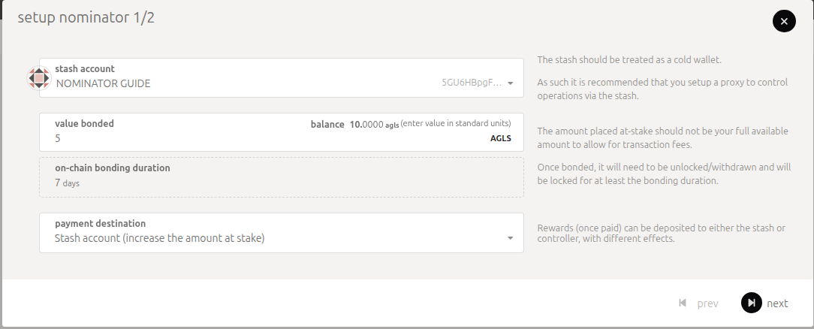
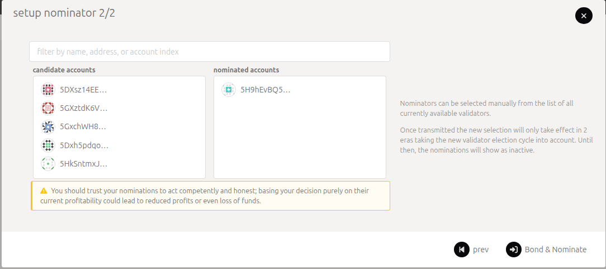
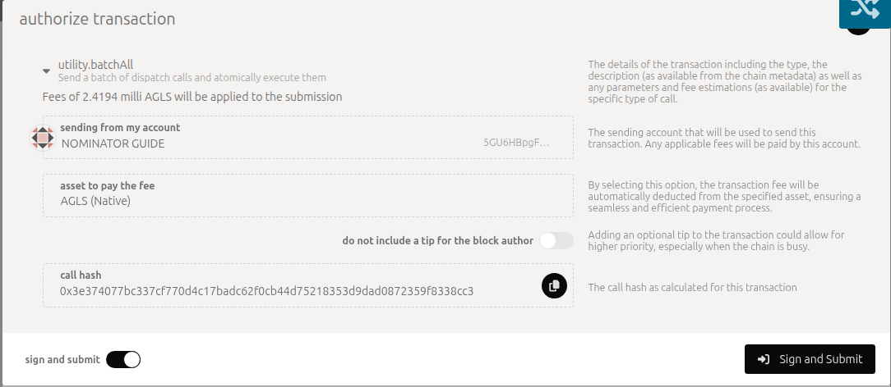
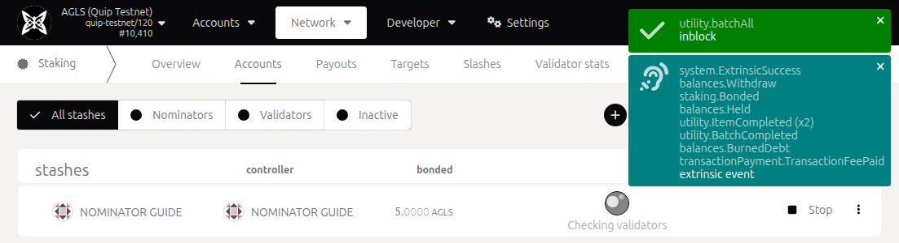

# Nominate A Validator (TestNet)

How to back testnet validators with your AGLS, claim your share of their rewards, and stop.

## How nominating works on Quip

* Nominating needs no node and no approval. You bond AGLS (the testnet token) from your account, which becomes your stash, and choose up to 16 validators to back. Your stake counts toward theirs in each validator election.
* Only validators approved by the Quip Foundation can be elected. A nomination for a validator that isn't approved counts for nothing until it is approved.
* Sessions last 1 hour and an era is 6 sessions (6 hours). A new nomination counts from the next era (see [When your nomination counts](#when-your-nomination-counts)).
* Every era, each active validator earns AGLS rewards. The validator first keeps its commission. The rest is shared between the validator and its nominators in proportion to their stake. Rewards are paid only when someone claims them (see [Claim your rewards](#claim-your-rewards)).
* If a validator you back is slashed for signing twice, its nominators for that era lose the same share of the stake they put behind it. The slash is applied 28 eras (about 7 days) after the offence. Back validators you trust to run their node carefully.
* Unbonded AGLS stays locked for 28 eras (about 7 days) before you can withdraw it.

## What you need

* A web browser for the Polkadot.js portal ([portal.aglais.quip.network](https://portal.aglais.quip.network)).
* A Quip account: a recovery phrase that the portal imports with **From Quip mnemonic**. Step 1 makes one with the node software, which needs Docker.
* At least **6 AGLS**: 5 to bond (the current minimum nominator bond) and 1 for fees. One request to the [faucet](https://agls.quip.network/#faucet) gives you 10.

## Step 1: Create and fund your account

Follow [Step 1 of Run A Validator](run-a-validator-testnet.md#step-1-create-your-stash-account): generate a recovery phrase with the node software, import it in the portal with **Accounts → From Quip mnemonic**, and request AGLS from the faucet for the address the portal shows. That account is your stash.


The portal keeps an imported account only until you reload or close the page. Import the phrase again whenever you come back or reload. Use only **From Quip mnemonic**: the other account buttons make ordinary keys that cannot sign Quip transactions.


## Step 2: Choose validators

1. Open **Network → Staking → Overview**. With **Active** selected, the list shows the active validators. For each one it shows its era points so far this era (the number in the badge), the stake of its nominators (**other stake**) and its **commission**. The arrow at the end of a row shows its **own stake**.
2. Note the addresses of the validators you want to back. The next step lists validators by address only, and it also lists validators under **Waiting**, which may never be elected.

Prefer validators that stay online: validators earn era points by producing blocks, and rewards follow era points. A lower commission leaves more of each reward for nominators.

## Step 3: Bond and nominate

In the portal, open **Network → Staking → Accounts** and choose **+ Nominator**.

1. **Setup Nominator 1/2**: pick your stash. Replace the **value bonded** with at least 5, and keep at least 1 AGLS unbonded, because later steps such as Stop and Unbond each cost a small fee that bonded funds cannot pay. For the payment destination, **Stash account (increase the amount at stake)** adds your rewards to your bond, and **Stash account (do not increase the amount at stake)** keeps them free to spend. The **on-chain bonding duration** shows 7 days: that is how long funds stay locked after you unbond. Choose **next**.

   <figure></figure>

   The portal may warn that the bonded amount is less than the current active minimum nominated amount. You can still continue. An election counts at most 64 backers per validator, largest stake first, and today every nominator fits.
2. **Setup Nominator 2/2**: under **candidate accounts**, choose the validators you noted in Step 2. Each one moves to **nominated accounts**. You can pick up to 16. Then choose **Bond & Nominate** and sign with your stash.

   <figure></figure>

   <figure></figure>
3. The portal confirms with a green **utility.batchAll** notice and a list of events that includes **staking.Bonded** and **utility.BatchCompleted**. Your stash shows its bond and **Stop** on **Staking → Accounts**.

   <figure></figure>

Until your nomination counts, the stash row may show **Checking validators** instead of the validators you chose. That is a display gap in the portal, not a problem with your nomination.

## When your nomination counts

The validators for the next era are elected during the last session (the last hour) of the current era. A nomination sent before then takes part in that election and counts from the next era. A nomination sent during the last hour counts from the era after that, up to about 7 hours later. The portal's note "will only take effect in 2 eras" describes that later case.

For example, a nomination sent early in era 3 counts from era 4, and its era-4 rewards can be claimed once era 5 starts.

To check your nomination, open **Developer → Chain state**, choose **staking** and **nominators**, pick your stash and choose **+**. It shows the validators you chose as `targets` and the era you sent it in as `submittedIn`. **Developer → Chain state → staking → activeEra** shows the current era.

## Claim your rewards

Each era's rewards can be claimed once the era has ended, and for 84 eras (21 days) after that. Older rewards can no longer be claimed.

1. Open **Network → Staking → Payouts**. With your stash imported, it lists the eras with unclaimed rewards from the validators you backed.
2. Choose **Payout all** and sign. Any account can send the claim and pay its small fee, and one claim pays the validator and all of its nominators for that era. If the validator or another nominator has already claimed an era, it no longer appears.

If **Payouts** doesn't list an era you expect, claim it in **Developer → Extrinsics**: choose **staking** and **payoutStakers**, set **validatorStash** to the validator's stash (not yours) and **era** to the era's number, then choose **Submit Transaction** and sign.

The rewards go to the payment destination you chose in Step 3. **Change reward destination** in your stash's menu (⋮) on **Staking → Accounts** changes it for later claims.

## Change your nominations

* To back other validators, open your stash's menu (⋮) on **Staking → Accounts** and choose **Set nominees**. The new list replaces the old one and counts from the next election, as in [When your nomination counts](#when-your-nomination-counts).
* To add to your stake, choose **Bond more funds** in the same menu.

## Stop nominating

1. On **Network → Staking → Accounts**, choose **Stop** on your stash. Your nominations end at the next election, and your AGLS stays bonded.
2. From your stash's menu (⋮) choose **Unbond funds** and enter the amount. Stop first: while you are still nominating, an unbond must leave at least 5 AGLS bonded.
3. The funds unlock after 28 eras (about 7 days). Then choose **Withdraw unbonded funds** from the menu.

Unbonding, rebonding and withdrawing work the same way as for validators, with the same dialogs: see [Leaving in Run A Validator](run-a-validator-testnet.md#leaving). To nominate again after **Stop**, choose **Nominate** on your stash.

## Known portal limitations

* Imported accounts are lost when you reload or close the page. The **Import** and **Export** buttons do not take Quip phrases.
* The validator lists show addresses, not names: the testnet has no on-chain identities.
* The stash row can show **Checking validators** for a long time while none of your validators has an active nominator.
* The testnet has no separate controller account: your stash signs every step, and **Change controller account** stays grayed out.
* More portal notes are in [Run A Validator](run-a-validator-testnet.md#known-portal-limitations).

## Where to go next

* [Run A Validator (TestNet)](run-a-validator-testnet.md) covers the validator side: running a node, getting approved and claiming for a whole validator.
* [Participants](../network/participants.md) describes the nominator role in the planned network design.
* [aglais.quip.network](https://aglais.quip.network) publishes the current testnet endpoints.
