# Run A Validator (TestNet)

How to join the Quip Network testnet as a validator, change your keys, and leave.

## How validating works on Quip

* Validators produce blocks and finalize them. Every validator key is a hybrid post-quantum key (a classical key plus FN-DSA-512), so the Polkadot.js portal ([portal.aglais.quip.network](https://portal.aglais.quip.network)) and the node have a few Quip-specific steps.
* Joining is approved, not automatic: you bond AGLS (the testnet token), register your node's keys, and declare that you want to validate. The Quip Foundation then approves your account, usually within 24 hours, and makes a seat for you. You are elected at the next validator election and join the active set one session (10 minutes) later.
* Sessions last 10 minutes and an era is 6 sessions (1 hour). After approval you are usually active within 10 to 20 minutes, or up to about 70 minutes if no new era is forced.
* Unbonded AGLS stays locked for 28 eras (about 28 hours) before you can withdraw it.
* The testnet pays no validator rewards yet, and nominating is switched off.

## What you need

* A Linux server that can run a Quip node around the clock, with port 30333/tcp open to inbound connections. Baseline: 4 CPU cores (x86_64), 8 GB of RAM, a 200 GB SSD and about 1 TB of network traffic a month. At today's activity a validator uses about 2 GB of RAM and well under one core, and its database grows by about 1.5 GB a day.
* Docker, to run the Quip node software. The commands on this page use the image `registry.gitlab.com/quip.network/quip-validator/quip-network-node` with the tag `v0.4.0`.
* The testnet chain spec, [aglais-network.json](https://gitlab.com/quip.network/nodes.quip.network/-/raw/main/chain-specs/aglais-network.json). The Step 2 commands download it.
* A shell with `curl` and `jq`.
* A web browser for the Polkadot.js portal.
* At least **6 AGLS**: 5 to bond (the current minimum validator bond) and 1 for fees. One request to the [faucet](https://agls.quip.network/#faucet) gives you 10.

## Step 1: Create your stash account

1. Generate a recovery phrase with the node software. This command prints only the phrase:

   ```sh
   docker run --rm --network none --log-driver none --entrypoint /usr/local/bin/quip-network-node \
     registry.gitlab.com/quip.network/quip-validator/quip-network-node:v0.4.0 \
     key generate --words 24 --output-type json | jq -r .secretPhrase
   ```

   The phrase controls your stash, so store it safely and never share it. You need it again for Stop, Unbond and Change session keys. Plain `key generate` also prints an Account ID and an SS58 address. Those belong to an ordinary key, not to your stash: never send AGLS to that address and never use that Account ID in Step 3. Make a new account for your stash rather than reusing one you already have, such as your miner's.
2. In the portal, open **Accounts**, choose **From Quip mnemonic**, paste the phrase and give the account a name. The address it shows is your stash address.

   <figure><a href="../.gitbook/assets/run-a-validator-import-from-quip-mnemonic.png">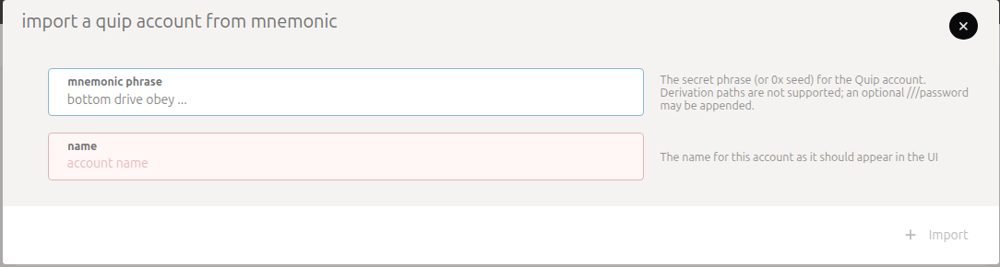</a></figure>
3. Paste that address into the [faucet](https://agls.quip.network/#faucet) and request AGLS. One request gives 10 AGLS, enough for the bond and the fees.


The portal keeps an imported account only until you reload or close the page. Import the phrase again whenever you come back or reload.

Use only **From Quip mnemonic**. The **Import** and **Export** buttons on the Accounts page handle encrypted backup files, not Quip phrases.

Leave **Settings → in-browser account creation** on "Do not allow local in-browser account storage". Allowing it adds the **Account** and **From JSON** buttons, which make ordinary keys that cannot sign Quip transactions. Pasting your Quip phrase there creates a different, non-Quip address and saves key material in the browser.


## Step 2: Run your validator node

1. Download the chain spec and start the node with `--validator`. Replace `YOUR_NODE_NAME` with a name for your node:

   ```sh
   mkdir -p "$HOME/quip-validator/data"
   curl -fsSL https://gitlab.com/quip.network/nodes.quip.network/-/raw/main/chain-specs/aglais-network.json \
     -o "$HOME/quip-validator/chain-spec.json"
   docker run -d --name quip-validator --restart unless-stopped --network host \
     -v "$HOME/quip-validator/data:/data" \
     -v "$HOME/quip-validator/chain-spec.json:/etc/quip/chain-spec.json:ro" \
     registry.gitlab.com/quip.network/quip-validator/quip-network-node:v0.4.0 \
     --chain=/etc/quip/chain-spec.json --base-path=/data --name=YOUR_NODE_NAME \
     --validator --unsafe-force-node-key-generation
   ```

   `--network host` keeps the node's RPC on the server's own 127.0.0.1, which Step 3 needs. Do not add `-p 9944:9944`, `--rpc-external` or `--unsafe-rpc-external`. The node keeps its database, network identity and session keys in `$HOME/quip-validator/data`, so keep that folder when you update or restart the container.
2. Step 3 calls an unsafe RPC method, one that writes keys. The node accepts it only over 127.0.0.1, so send it only from the server itself, and never make your node's unsafe methods reachable from other machines. A public RPC that serves only safe methods is fine. If you run the [Run A Node](run-a-node-testnet.md) stack (node manager or docker compose), use [Session keys on the Run A Node stack](#session-keys-on-the-run-a-node-stack) instead of Step 3.2.
3. Check that the node is on the testnet. This prints the hash of its first block, which must be `0x542a9915acf840b8940d35ca6de242f669a0c6e3b40f9a8d8c14b9bf7b8ebecb`:

   ```sh
   curl -s -H 'Content-Type: application/json' \
     -d '{"id":1,"jsonrpc":"2.0","method":"chain_getBlockHash","params":[0]}' \
     http://127.0.0.1:9944 | jq -r .result
   ```

   A different hash, or a node that stays at block #0 with 0 peers, means a wrong chain spec.
4. Wait until the node is fully synced: this shows `"isSyncing": false` and at least 1 peer, and the node's log (`docker logs quip-validator`) shows "Idle" lines.

   ```sh
   curl -s -H 'Content-Type: application/json' \
     -d '{"id":1,"jsonrpc":"2.0","method":"system_health","params":[]}' \
     http://127.0.0.1:9944 | jq .result
   ```

## Step 3: Generate session keys on your node

1. Get your Account ID from the stash address the portal showed in Step 1:

   ```sh
   docker run --rm --network none --entrypoint /usr/local/bin/quip-network-node \
     registry.gitlab.com/quip.network/quip-validator/quip-network-node:v0.4.0 \
     key inspect --output-type json YOUR_ADDRESS | jq -r .accountId
   ```

   It prints your **Account ID** (starts with `0x`). Pass the address that starts with `5`, never the phrase: `key inspect` on the phrase gives a different, ordinary account, and the chain then rejects your keys in Step 4.
2. Ask your node to generate session keys tied to your stash. It keeps the private keys in its keystore and returns the public keys plus an ownership proof:

   ```sh
   curl -s -H 'Content-Type: application/json' \
     -d '{"id":1,"jsonrpc":"2.0","method":"author_rotateKeysWithOwner","params":["ACCOUNT_ID"]}' \
     http://127.0.0.1:9944 > session-keys.json
   ```

   9944 is the default RPC port. Use yours if you changed it. The node accepts this command only while its RPC listens on `localhost` alone, which is the default and is intended. If you started the node with `--unsafe-rpc-external` or `--rpc-methods=safe` (the Run A Node stack does both), it refuses the command even from the same machine with "RPC call is unsafe to be called externally". Do not work around that with `--rpc-methods unsafe` on a port others can reach. Keys from plain `author_rotateKeys` have no proof and cannot be registered on Quip.
3. Check the result. The two numbers should be 3718 and 2926:

   ```sh
   jq -r '(.result.keys | length), (.result.proof | length)' session-keys.json
   ```

4. Print the two values you will paste in Step 4, the keys and then the proof. Paste them in this order, with no spaces before or after:

   ```sh
   jq -r .result.keys session-keys.json
   jq -r .result.proof session-keys.json
   ```

### Session keys on the Run A Node stack

The Run A Node stack runs its validator with `--unsafe-rpc-external --rpc-methods=safe`, so it refuses Step 3.2. Instead, start a short-lived second node from the same image on the same server. It writes the new keys straight into your validator's keystore, and your validator uses them without a restart. Run this on the server, with your Account ID from Step 3.1:

```sh
DATA=$(docker inspect -f '{{range .Mounts}}{{if eq .Destination "/data"}}{{.Source}}{{end}}{{end}}' quip-validator)
SPEC=$(docker inspect -f '{{range .Mounts}}{{if eq .Destination "/etc/quip/chain-spec.json"}}{{.Source}}{{end}}{{end}}' quip-validator)
KS="$DATA/chains/quip_testnet/keystore"
docker run -d --rm --name quip-keygen --network host --user "$(stat -c %u:%g "$KS")" \
  -v "$SPEC:/spec.json:ro" -v "$KS:/keystore" \
  --entrypoint /usr/local/bin/quip-network-node "$(docker inspect -f '{{.Image}}' quip-validator)" \
  --chain /spec.json --tmp --keystore-path /keystore \
  --rpc-port 9945 --listen-addr /ip4/127.0.0.1/tcp/30399 --no-prometheus
sleep 15
curl -s -H 'Content-Type: application/json' \
  -d '{"id":1,"jsonrpc":"2.0","method":"author_rotateKeysWithOwner","params":["ACCOUNT_ID"]}' \
  http://127.0.0.1:9945 > session-keys.json
docker stop quip-keygen
```

The second node listens only on 127.0.0.1 and removes itself when stopped. `quip-validator` is the validator container's name in the Run A Node stack. Then continue with Step 3.3.

## Step 4: Bond, register your keys and validate

In the portal, open **Network → Staking → Accounts** and choose **+ Validator**.

1. **Setup Validator 1/2**: pick your stash. The **value bonded** field starts with almost your whole balance: replace it with at least 5 and keep at least 1 AGLS unbonded, because later steps such as Stop, Unbond and Change session keys each cost a small fee that bonded funds cannot pay. Pick either **Stash account** option as the payment destination (there are no rewards yet). The **on-chain bonding duration** shows 1 day 4 hrs: that is how long funds stay locked after you unbond. Choose **next**.

   <figure><a href="../.gitbook/assets/run-a-validator-setup-bond.png">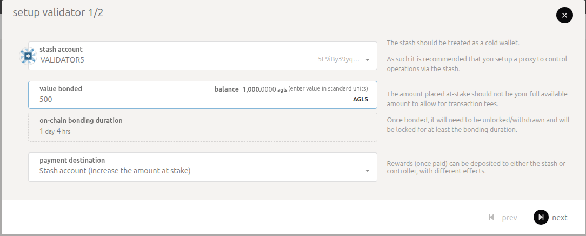</a></figure>
2. **Setup Validator 2/2**: paste the keys into **Keys from rotateKeysWithOwner** first, then the proof into **Session key ownership proof**. Changing the keys afterward empties the proof field, so paste the proof last. Leave **allows new nominations** as it is: nominating is switched off. Set your commission, then choose **Bond & Validate** and sign with your stash.

   <figure><a href="../.gitbook/assets/run-a-validator-setup-keys-and-proof.png">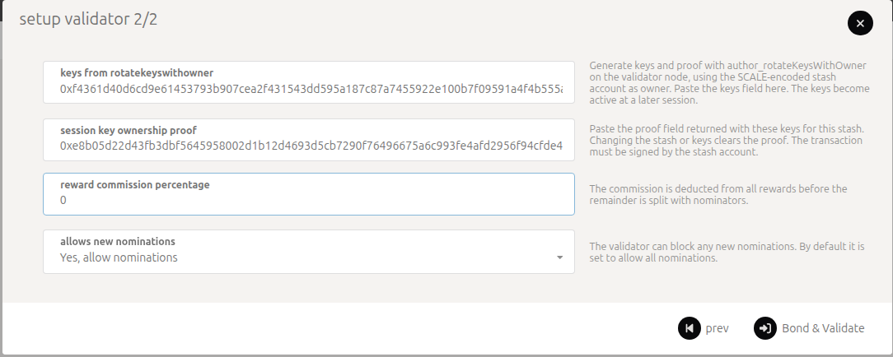</a></figure>

   <figure><a href="../.gitbook/assets/run-a-validator-authorize.png">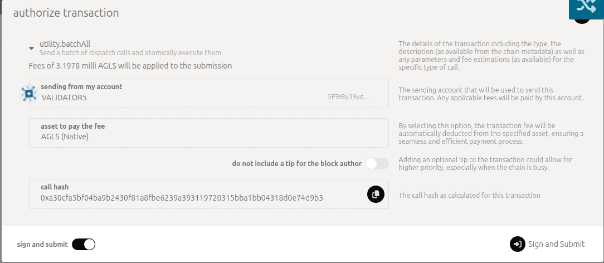</a></figure>
3. The portal confirms with a green **utility.batchAll** notice and a list of events that includes **staking.Bonded** and **staking.ValidatorPrefsSet**, and your stash shows **Stop** on **Staking → Accounts**.

   <figure><a href="../.gitbook/assets/run-a-validator-bond-and-validate-done.png">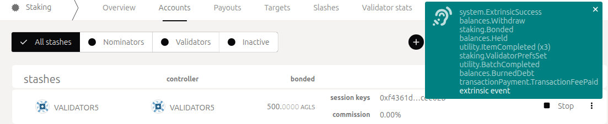</a></figure>
4. Your stash now appears on **Staking → Overview** when you switch the list to **Waiting**.

   <figure><a href="../.gitbook/assets/run-a-validator-waiting-list.png">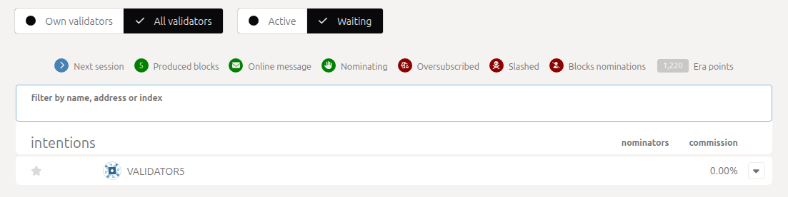</a></figure>

## Step 5: Wait for approval

You don't need to send anything. The Quip Foundation approves the stashes listed under **Waiting**, in one vote that also adds a seat and starts a new era. Allow up to 24 hours. While you wait, check that your part is in place:

* **Staking → Overview**, with the list switched to **Waiting**, shows your stash.
* **Staking → Accounts** shows your stash with at least 5 AGLS bonded, its session keys and the **Stop** button.
* **Developer → Chain state**: choose **session** and **nextKeys**, pick your stash and choose **+**. It shows your session keys. If it shows `<none>`, your keys are not registered: set them with **Change session keys** (step 3 of [Change your session keys](#change-your-session-keys-or-move-to-a-new-server)).
* Your node stays synced, with at least 1 peer (Step 2.4).

After the vote, you are included in the next election.

## Step 6: Check that you are active

* **Staking → Overview** lists your stash among the active validators.
* **Network → Explorer** shows blocks authored by your address.
* Your node's log shows lines like "Prepared block for proposing" and "Pre-sealed block". Such a line means your node produced a block; Explorer shows whether it stayed in the chain.

You are usually active 10 to 20 minutes after the Foundation's vote. Keep your node online (see [If your node goes offline](#if-your-node-goes-offline)).

## Change your session keys or move to a new server

1. Start the new node ([Step 2](#step-2-run-your-validator-node)) and wait until it is fully synced. Keep the old node running.
2. Run [Step 3](#step-3-generate-session-keys-on-your-node) on the new node.
3. On **Network → Staking → Accounts**, open your stash's menu (⋮) and choose **Change session keys**. In the **Set Session Key** dialog, paste the new keys first, then the proof, choose **Set Session Key** and sign with your stash.

   <figure><a href="../.gitbook/assets/run-a-validator-set-session-key.png">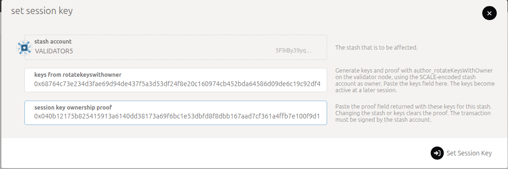</a></figure>
4. Wait for two session changes (10 to 20 minutes). The new keys are queued at the first and take over at the second. The new node's log then shows "Pre-sealed block" lines, and the old node stops producing blocks.
5. Stop the old node. Never run two nodes with the same keys.

The old node's last block comes just before the session change, and the new node's first block just after it.

## If your node goes offline

* The network carries on without you. Blocks keep coming, a little slower because your slots stay empty.
* Finality needs more than two thirds of the active validators online: 3 of 3, 3 of 4, 4 of 5. With fewer online, blocks are still produced but are not finalized until enough validators are back. **Staking → Overview** shows how many validators are active.
* Keep your node online. If it stops producing blocks for 21 minutes or more, that counts as an outage. The first outage is recorded as a warning, and you keep your seat.
* A second outage, or a first one that lasts more than 6 hours, gets your stash removed from the active set. The Foundation removes your approval and won't approve that stash again, even if your node is back by then.
* A restart of a few minutes, for example to update your node, doesn't count, and neither do outages the network causes. To take your node down on purpose, see [Take your node down for maintenance](#take-your-node-down-for-maintenance).

## Take your node down for maintenance

To restart your server, update its operating system or take the node down for any other planned work, leave the active set first. Downtime after you have left does not count as going offline.

1. On **Network → Staking → Accounts**, choose **Stop** on your stash. You leave the active set when the next era starts, within about 70 minutes. Keep your node running until **Staking → Overview** no longer lists you as active.
2. Do the maintenance.
3. Start the node and wait until it is fully synced (see [Step 2](#step-2-run-your-validator-node)).
4. On **Network → Staking → Accounts**, choose **Validate** on your stash, set your commission and sign. Your approval and your bond stay in place, so you are a candidate at the next election and active again within about 70 minutes.

To move to a new server without a break, see [Change your session keys or move to a new server](#change-your-session-keys-or-move-to-a-new-server) instead.

## Leaving

1. On **Network → Staking → Accounts**, choose **Stop** on your stash. You leave the active set when the next era starts. If you choose Stop during an era's last 10 minutes, the next era's validators are already chosen, so you stay one more era (up to about 70 minutes). Keep your node running until **Staking → Overview** no longer lists you as active.

   <figure><a href="../.gitbook/assets/run-a-validator-stop.png">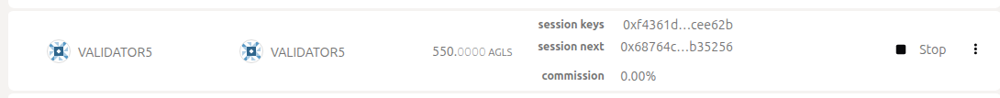</a></figure>
2. From your stash's menu (⋮) choose **Unbond funds** and enter the amount. Stop first: while you are still validating, an unbond must leave at least 5 AGLS bonded.

   <figure><a href="../.gitbook/assets/run-a-validator-unbond.png">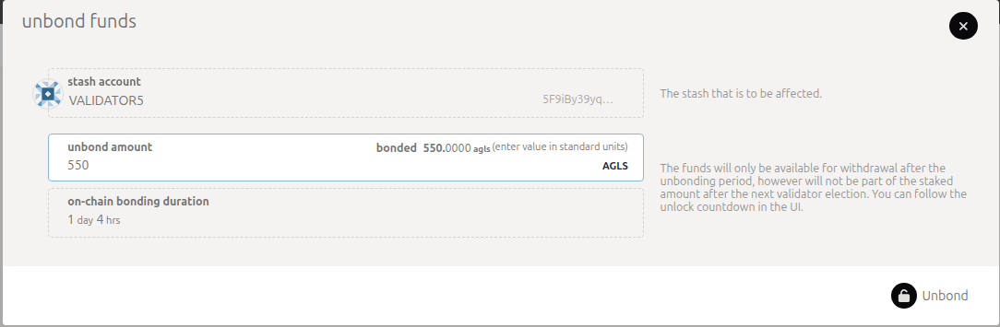</a></figure>
3. The funds unlock after 28 eras (about 28 hours). Until then the stash's row shows a clock icon next to the amount (hover it for the time left), and **Withdraw unbonded funds** stays grayed out.
4. From the menu choose **Withdraw unbonded funds**. It starts working about 10 minutes before the countdown ends, because the chain counts the next era as soon as it is planned.

   <figure><a href="../.gitbook/assets/run-a-validator-withdraw-menu.png">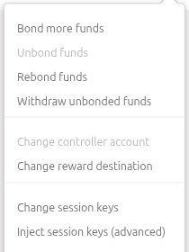</a></figure>

* Changed your mind while the countdown is still running? **Rebond funds** moves unlocking funds back into your stake. Its dialog is titled "Bond more funds"; the button says **Rebond**. Once the countdown has ended, withdraw first, then bond again with **Bond more funds** (or **+ Stash** if you had unbonded everything). If you chose **Stop**, choose **Validate** again.

  <figure><a href="../.gitbook/assets/run-a-validator-unlocking-row.png">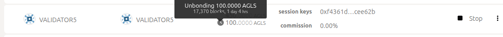</a></figure>

  <figure><a href="../.gitbook/assets/run-a-validator-rebond.png">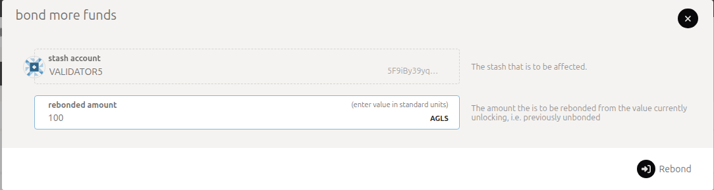</a></figure>
* Add to your stake at any time with **Bond more funds**.

  <figure><a href="../.gitbook/assets/run-a-validator-bond-more.png">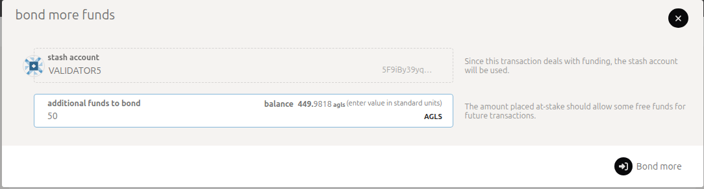</a></figure>
* Your Foundation approval stays after you leave. If you validate again later, you are a candidate at the next election. Seats go to the highest stakes: you rejoin if a seat is free, or if your stake is higher than the lowest active validator's, who then drops out.
* If the Foundation removes your approval, you leave the active set 10 to 20 minutes after its vote. Keep your node running until **Staking → Overview** no longer lists you as active. Your bond stays until you unbond it.

## Known portal limitations

* **Inject session keys (advanced)** does not work with Quip keys, and its "relay chain" warning does not apply here.
* Imported accounts are lost when you reload or close the page. The **Import** and **Export** buttons do not take Quip phrases.
* **+ Nominator** fails, because nominating is switched off.
* **Payouts** is empty, because there are no validator rewards yet.
* On first load, the Staking summary can show wrong numbers such as "validators N / 0" or an era over 100%. Reload the page, then import your phrase again.
* A validator whose commission is exactly 0 shows **Validate** instead of **Stop**. The portal never sends exactly 0 (it sends 1 per billion when you enter 0), but accounts set up outside the portal can have it. Choose **Validate** to set a commission first; **Stop** then appears.
* The testnet has no separate controller account: your stash signs every step, and **Change controller account** stays grayed out.

## Where to go next

* [Run A Node (TestNet)](run-a-node-testnet.md) covers the node manager and running a node on a server.
* [Participants](../network/participants.md#validators) describes the validator role in the planned network design.
* [aglais.quip.network](https://aglais.quip.network) publishes the current testnet endpoints.
